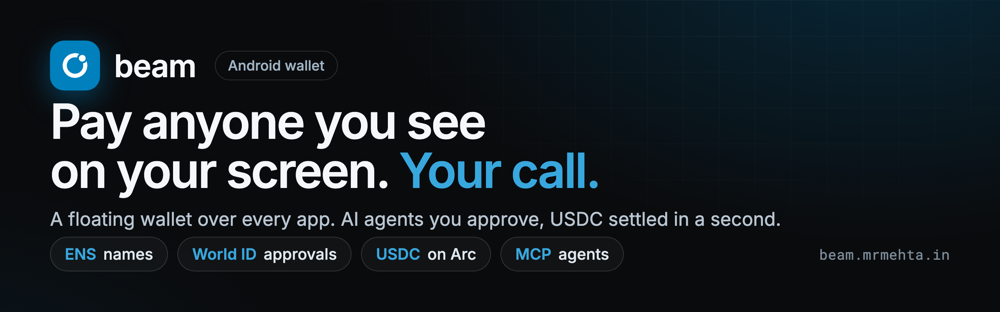

# Beam

**Pay anyone you see on your screen.** Beam is an Android wallet with a floating beam that sits over every app. Tap it in WhatsApp, X or Telegram, say "pay this", review, confirm with your fingerprint, and USDC settles on Arc in about a second. You never leave the app you were in.

**Arc settles the money, ENS says who it goes to, and World ID proves a real human approved it.**

🌐 **[beam.mrmehta.in](https://beam.mrmehta.in)** · 💻 **[github.com/kartikmehta8/beam](https://github.com/kartikmehta8/beam)** · 🎬 [Demo video](ethglobal/video/beam-demo.mp4)

---

## Try it in 3 steps

1. **Install** the APK from [beam.mrmehta.in/download](https://beam.mrmehta.in/download).
2. **Sign in**, then **Wallet → Faucet** for test USDC on Arc.
3. In any app, show `send $12 to vitalik.eth`, tap the beam, **Pay this**, confirm with your fingerprint.

> Full walkthrough (World ID, caps, agents) is in [Try it](#try-it) below.

---

## Deployed contracts

| Contract | Network | Address |
|---|---|---|
| **BeamPay** (payments, receipts, onchain cap, World-approved sends) | Arc Testnet (chain `5042002`) | [`0xacf090CD5d5a6636B7b757A6d324c12B6721Fa1c`](https://explorer.testnet.arc.io/address/0xacf090CD5d5a6636B7b757A6d324c12B6721Fa1c) |
| **Beam handle registry** (ENSv2, parent `beamfi.eth`) | Sepolia | [`0x16aD5F85960E389e754BA84406974f437913217a`](https://sepolia.etherscan.io/address/0x16aD5F85960E389e754BA84406974f437913217a) |

Payments are in USDC, the native gas token on Arc. Explorer: [explorer.testnet.arc.io](https://explorer.testnet.arc.io) · RPC: `https://rpc.testnet.arc.io`

---

## How it works

```
┌──────────────────────────────── Android phone ────────────────────────────────┐
│ Any app ── beam tap ──► ScreenReaderService.captureNow ──► /ask sheet          │
│ Beam app: Privy embedded wallet (signs locally) · viem (Arc + ENS reads)       │
│   review card ── needs approval? ──► World App (World ID 4.0 proof)           │
│   BeamPay.pay / payWithApproval ─────────────────────────────► Arc testnet     │
└───────────────────────────────┬───────────────────────────────────────────────┘
                                │ HTTPS + bearer token
┌───────────────────────────────▼───────────────────────────────────────────────┐
│ Beam server (Hono)                                                             │
│  /v1/agent      Claude tool loop: balance · inspect_recipient · prepare_payment│
│                 · get_tx_status · ask_user                                    │
│  /v1/approvals  IDKit proof → verified by World → EIP-712 approval            │
│  /v1/handles    ENSv2 registrar: <label>.<parent>.eth, one per human          │
│  MCP server     same tools; external-agent payments always need World ID     │
└───────────────────────────────────────────────────────────────────────────────┘
```

| Path | What |
|---|---|
| `app/` | Expo SDK 53 app: tabs (Wallet, Activity, Beam, Profile), the `/ask` and `/review` sheets, `modules/bubble-overlay/` Kotlin module |
| `server/` | Agent server, World ID approvals, ENS handles, MCP server, vitest tests. See [server/README.md](server/README.md) |
| `contracts/` | `BeamPay` (Foundry): receipts, onchain per-payment cap, World-approved payments. See [contracts/README.md](contracts/README.md) |
| `server/src/handles/` | ENSv2 handle registrar and setup. See [server/src/handles/README.md](server/src/handles/README.md) |

## What's inside

- The beam overlay, screen capture, the Claude agent and a Privy embedded wallet.
- USDC payments on Arc testnet with device-side limits.
- The `BeamPay` contract (receipts, onchain cap, approvals).
- World ID approvals for risky agent payments.
- Paying ENS names seen on screen.
- ENSv2 Beam handles.
- An external-agent review flow over MCP.

## Prerequisites

- Node 20.12+, pnpm (app), npm (server), Foundry (contracts), ngrok
- JDK 17 and the Android SDK, an Android 10+ phone with USB debugging
- Privy app (email login, EVM embedded wallets; mobile client allows `com.bubbleagent.app` and scheme `bubbleagent`)
- Anthropic API key (optional; without it the server uses the offline parser)

## Run

```bash
# 1. Contracts: deploy BeamPay to Arc testnet (once; already live at the address above)
cd contracts                       # see contracts/README.md for dependency setup
#   fund the deployer address with test USDC at https://faucet.circle.com (choose Arc Testnet)
source .env && forge script script/DeployBeamPay.s.sol --rpc-url https://rpc.testnet.arc.io --broadcast --private-key $DEPLOYER_PRIVATE_KEY
#   copy the printed address into server/.env BEAMPAY_ADDRESS and app/.env EXPO_PUBLIC_BEAMPAY_ADDRESS

# 2. Server
cd server && npm install && npm run dev

# 3. Tunnel (second terminal)
ngrok http --url=<your-domain>.ngrok-free.dev 8787

# 4. App (third terminal, phone plugged in)
cd app && pnpm install && pnpm android
```

`WORLD_MODE=staging` (dev only) sends World ID approvals to the World ID simulator (https://simulator.worldcoin.org), so every path can be tried without a Beam-verified World App; `production` uses the real World App. The server refuses staging in production. See the World ID section of the server README. ENS handles stay off until the ENS variables are set (see the handles README).

## Try it

1. Sign in, then **Wallet → Faucet** for test USDC on Arc.
2. On the **Beam** tab, grant the permissions in Setup and turn the beam on.
3. **Profile → World ID → Link**: approve in World App (or the simulator in staging). The wallet is now bound to that human onchain.
4. In any app, show `dinner was $12, send to 0x<address>` or `send $12 to vitalik.eth`, then tap the beam and **Pay this**. The card shows the ENS name, avatar and primary-name badge. Confirm with your fingerprint.
5. Over the $25 cap, or the first payment of $10 or more to someone new: **Approve with World ID**, then Confirm. Decline in World App instead and nothing is sent. A different human than the linked one is rejected.
6. **Profile → Limits**: lower the per-payment cap instantly, or raise it with World ID.
7. External agent: connect Claude Code or Codex to the hosted Beam MCP, call `prepare_payment`, and open the returned `reviewLink` on the phone. It always needs World ID.

## Permissions

| Permission | Why |
|---|---|
| Display over other apps | Draws the beam. Required. |
| Accessibility ("Beam screen reader") | Reads visible text only at the moment you tap the beam. Without it, use the clipboard. |
| Notifications (Android 13+) | The notification that keeps the beam running. |
| Battery optimisation exemption | Stops the system from killing the beam. |

If you sideloaded the APK, enable accessibility via App info → ⋮ → **Allow restricted settings**.

## Security

- **Keys:** user keys stay in the Privy embedded wallet. The server holds two narrow keys:
  - an **approver**, which signs World-backed approvals and cannot move funds;
  - an **ENS registrar**, which can create and revoke handles and has no role over anyone's records.
- **The cap is onchain:** amounts over it need an approval signature that the server only issues after World verifies a fresh World ID proof bound to that exact approval (signal), from the human bound to the wallet.
- **World ID binding:** the server sees only an app-scoped World ID session id. The chain stores only a salted hash of it.
- **Recipients:** they must appear on screen or in your message. Names are resolved independently by the server and the phone, and a mismatch blocks the payment. A name that now points to a new address needs World ID.
- **No blind sends:** every payment is dry-run before signing, and sends are never retried.
- **Screen reading:** the screen is read only when you tap the beam. Captures stay in memory for at most 120 seconds, and logs carry lengths and masked addresses only.
- **Threat model:** the cap guards the agent path. A user can still send funds directly from their wallet.
- **Demo-grade auth:** `EXPO_PUBLIC_AGENT_TOKEN` ships inside the APK.
